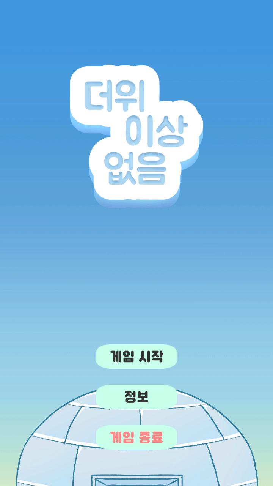
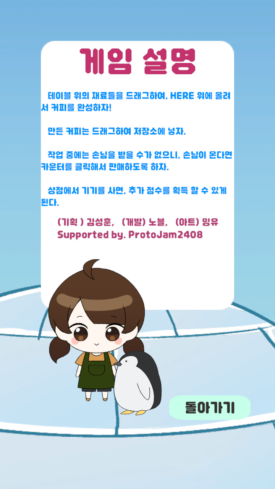
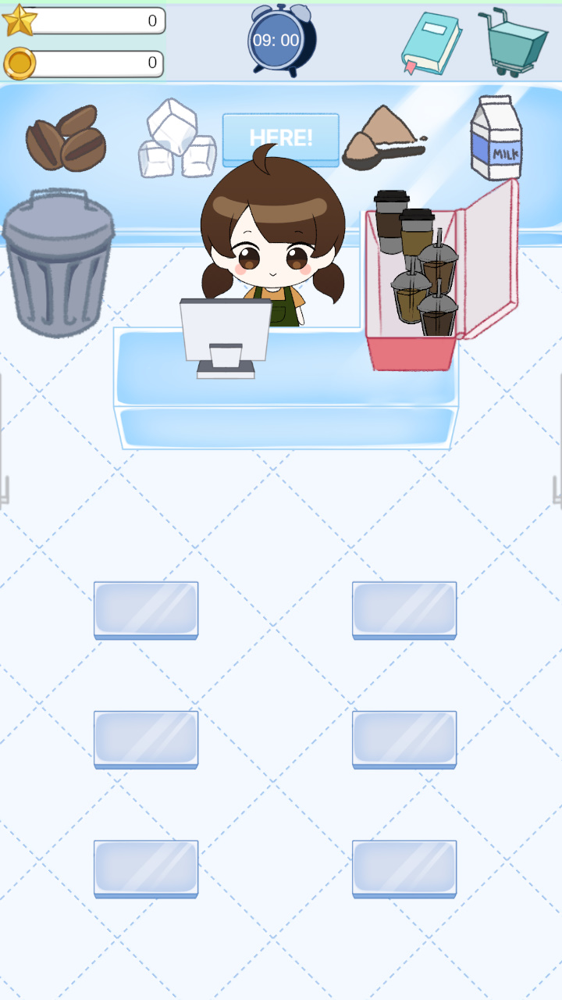
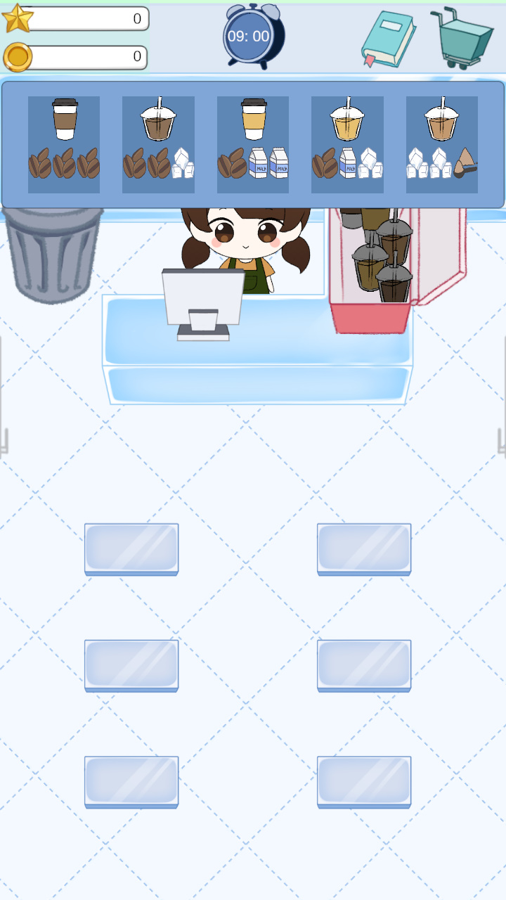
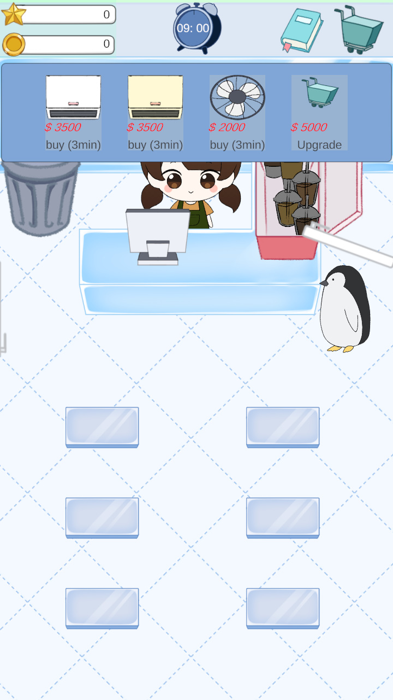
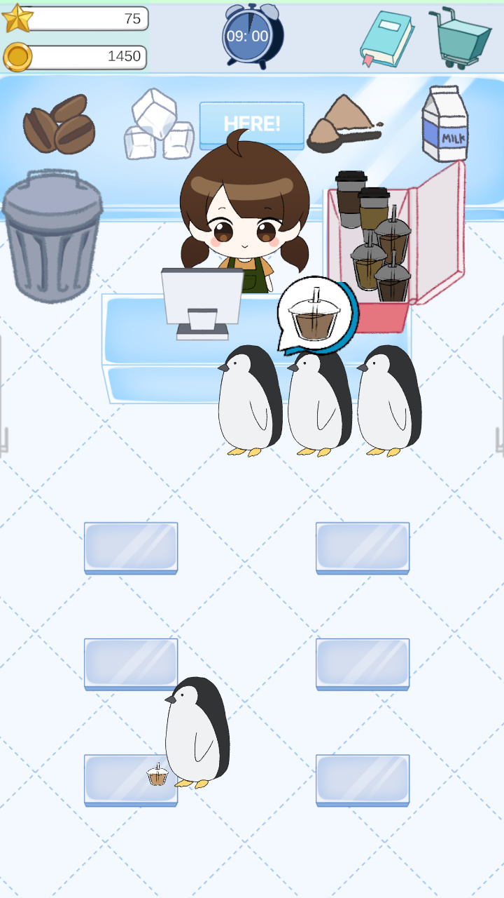
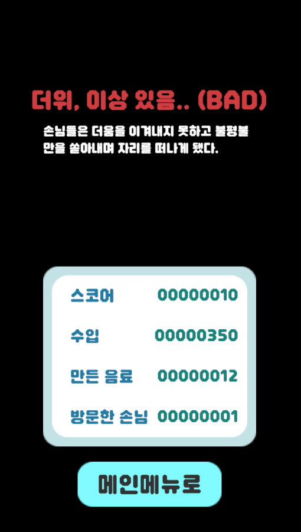
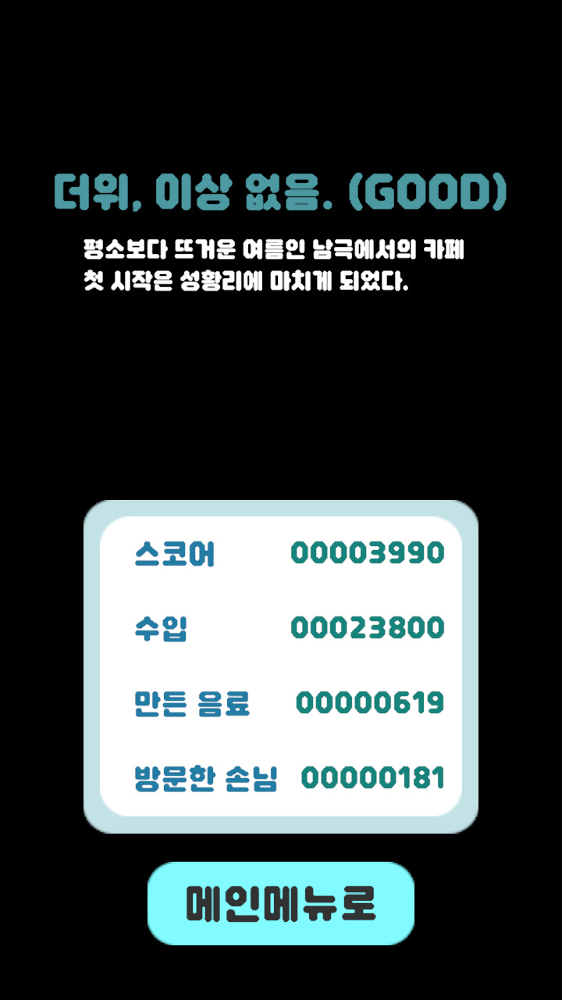

# 더위, 이상 없음. (No Problem Heat)  -  ProtoGameJam2408

Developed Period.
2024-08-04 ~ 2024-08-18

Proto Game Jam 2024.08

### 원본 저장소

이 저장소는 공개용입니다. 에셋을 포함한 전체 프로젝트 원본은 비공개 저장소 `ProtoGameJam2408-Archive`에 따로 보관하고 있습니다.

원본에는 팀원이 그린 그림과 소리·폰트 리소스가 들어 있어 그대로 공개하지 않습니다. 그래서 여기에는 **직접 작성한 코드와 게임 화면 캡처만** 옮겼고, 이 저장소만 받아서는 프로젝트를 열어 실행할 수 없습니다.

### 빌드 다운로드

실행 파일은 이 저장소의 [Releases](https://github.com/noble-shake/ProtoGameJam2408/releases)에 올립니다.

현재는 준비 중이며, 올라오면 Releases 페이지에서 받을 수 있습니다.

### 폴더 구조

```
ProtoGameJam2408/
├── Assets/
│   └── Scripts/              게임 코드 전체
│       ├── CharacterScripts/ 손님(펭귄·사람)의 입장·주문·퇴장
│       ├── GameScripts/      게임 진행, 주문, 테이블, 음료 재고
│       ├── ItemMakeScripts/  재료 조합, 음료, 보관함, 쓰레기통
│       ├── UI/               레시피, 상점, 결과 화면
│       └── MainScript.cs, Tutorial.cs, WorkInteraction.cs, WorkObject.cs
├── docs/                     README에 쓰는 게임 화면 캡처
├── Packages/manifest.json    사용한 Unity 패키지 목록
└── ProjectSettings/ProjectVersion.txt   엔진 버전
```

- 엔진: Unity 2022.3.21f1

### 장르 (THEME) 
  타이쿤

### 게임 컨셉 (CONCEPT) 
  더워서 남극까지 더워졌다. 그러니 시원한 카페를 열자!

### 게임 소개 (INTRODUCTION) 
  레시피를 보며 알맞은 재료로 음료를 만든 뒤에, 저장고에 저장, 손님에게 제공해주는 게임.

### 게임 방법 (HOW TO PLAY)
  1. 재료를 드래그하여, 작업 공간 (HERE)에 넣어서 레시피대로 음료를 완성한다.

  2. 완성한 은료는 저장소로 드래그하여 보관 할 수 있다.

  3. 손님이 계속 가게에 들어오며, 각자 원하는 음료를 주문한다.

  4. 플레이어는 음료를 만드는 도중에는 주문을 받을 수 없다. 카운터를 눌러서 주문 상태로 바꿔주면, 알아서 음료를 제공한다.

  5. 레시피에 맞지 않는 음료는 쓰레기 통에 버려야 한다.

  6. 레시피 버튼을 눌러서, 어떤 음료를 만들 수 있는지 확인한다.

  7. 상점 버튼을 눌러서, 획득한 재화를 사용해 추가 점수를 얻을 수 있는 기기를 설치한다.

  8. 스토어 업그레이드를 통해, 한번에 저장할 수 있는 수를 늘릴 수 있다.

  9. 제한 시간이 끝나고, 손님이 모두 나가면 게임이 끝난다.

  10. 스코어가 일정 미만이면 배드 엔딩, 이상이면 굿 엔딩을 출력한다.

  11. 결과 창에는 점수, 재화, 방문한 손님, 만든 음료 갯수가 출력된다.


### 게임 화면 (PREVIEW)

| 메인 화면 | 게임 설명 | 게임 화면 | 레시피 |
  |:---:|:---:|:---:|:---:|
  | | | ||
  | **상점 화면** | **플레이 화면** | **배드 엔딩** | **굿 엔딩** | |
| |  |  |  | |


### 개발자 (DEVELOPER)

- 기획자 (DESIGNER) : 김성훈
  
  Contact.
  
  Email : drahoon@naver.com
  
  Twitter : @bauni_p
  
- 개발자 (PROGRAMMER) : 노블
  
  Contact.
  
  Email : noble_shake@naver.com

  
- 그래픽 디자이너 (GRAPHIC) : 밍유
  
  Contact.
  
  Twitter : @U_Min_g
